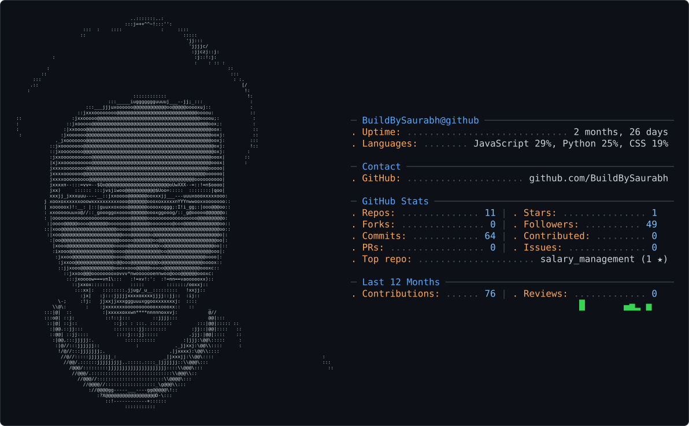

<picture>
  <source media="(prefers-color-scheme: dark)" srcset="dark_mode.svg" />
  <source media="(prefers-color-scheme: light)" srcset="light_mode.svg" />
  
</picture>

---

 

<!--  -->

---

## About Me

Hi, I'm **Saurabh Waghmare**, a Python Full Stack Developer with **3+ years of professional experience** building web applications, REST APIs, and database-driven solutions.

I enjoy backend engineering, building practical frontend experiences, and exploring AI-powered applications.

- 🔭 Building and improving **[MeetLocal](https://meetlocal-inix.onrender.com/)**
- 🧠 Learning and exploring Generative AI, RAG, AI agents, and full-stack architecture
- ⚙️ Working with Python, Django, React, PostgreSQL, and REST APIs
- 🚀 Interested in useful products, clean code, and scalable applications
- 🌐 Portfolio: [portfolio-j3ox.onrender.com](https://portfolio-j3ox.onrender.com/)
- 📫 Contact: [Saurabhwaghamare@gmail.com](mailto:Saurabhwaghamare@gmail.com)

---

## Featured Projects

<table>
<tr>
<td width="50%" valign="top">

### ◈ MeetLocal

Browser-based meeting platform exploring real-time communication and local AI workflows.

**Core technologies**

[Live Project ↗](https://meetlocal-inix.onrender.com/) · [Repository ↗](https://github.com/BuildBySaurabh/MeetLocal)

</td>
<td width="50%" valign="top">

### ◈ Smart Job Portal

Full-stack job portal with authentication, role-based access, and job-related workflows.

**Core technologies**

[Live Demo ↗](https://job-portal-ohk7.onrender.com/) · [Repository ↗](https://github.com/BuildBySaurabh/Job_Portal)

</td>
</tr>
<tr>
<td width="50%" valign="top">

### ◈ AI Resume Screening

AI-focused project exploring resume screening and retrieval-augmented generation.

[Live Demo ↗](https://resume-screening-c5dk.onrender.com/) · [Repository ↗](https://github.com/BuildBySaurabh/Resume-Screening)

</td>
<td width="50%" valign="top">

### ◈ Developer Portfolio

A personal portfolio for showcasing my development background and projects.

[Visit Portfolio ↗](https://portfolio-j3ox.onrender.com/)

</td>
</tr>
</table>

---

## Languages & Technologies

### Programming languages

### Backend & frameworks

### Frontend

### Databases

### AI, machine learning & computer vision

### Tools, DevOps & platforms

---

## GitHub Analytics

  

---

## Connect

 

### `BUILD • LEARN • INNOVATE`

*Building intelligent solutions. Engineering ideas into reality.*

